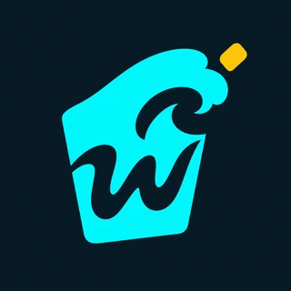
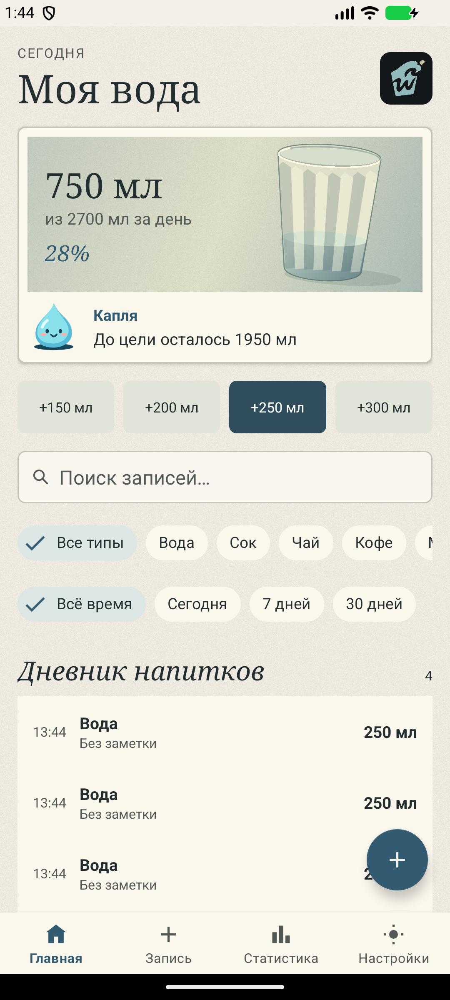
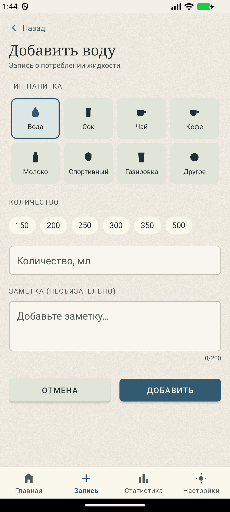
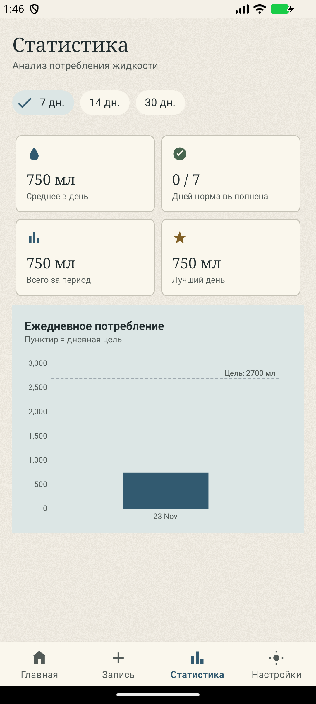
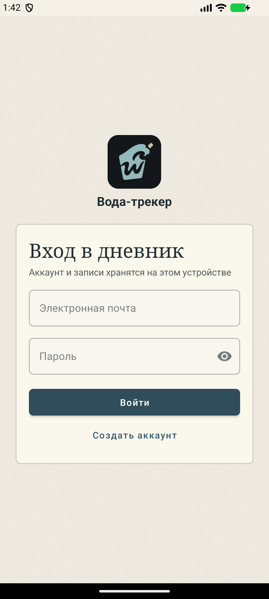

<div align="center">
  

# Вода-трекер

**Ещё один стакан — ещё одна запись в дневнике.**

Android-приложение для учёта воды и других напитков с наполняющимся стаканом, статистикой и виджетом рабочего стола.


[Возможности](#возможности) · [Экраны](#экраны) · [Запуск](#запуск) · [Устройство проекта](#устройство-проекта)

</div>

## О приложении

Вода за завтраком, чай на работе, стакан после прогулки. Вода-трекер помогает записывать напитки, видеть итог дня и следить за собственной целью. Бумажная текстура, кремовые карточки и спокойные синие оттенки продолжают оформление рекламного сайта проекта.

Гранёный стакан на главном экране наполняется вместе с дневным прогрессом. Рядом живёт Капля — маленький помощник, который показывает остаток до цели и поздравляет с её достижением.

## Возможности

- **Дневник напитков** — добавление, редактирование и удаление записей, объём, дата и заметка.
- **Восемь типов напитков** — вода, сок, чай, кофе, молоко, спортивный напиток, газировка и другое.
- **Быстрые порции** — вода по 150, 200, 250 и 300 мл с главного экрана, произвольный объём в форме.
- **Поиск и фильтры** — поиск по заметке, фильтрация по напитку и периоду, выбор сортировки.
- **Статистика за 7, 14 и 30 дней** — график, средний объём, общий итог, лучший день и дни выполнения цели.
- **Личные настройки** — дневная цель от 500 до 5000 мл, миллилитры, унции или стаканы.
- **Локальные аккаунты** — регистрация, вход, выход и отдельный дневник для каждого профиля.
- **Напоминания** — периодические уведомления через WorkManager, включаются в настройках.

### Изюминка проекта

Виджет «Моя вода» позволяет отметить **150, 250 или 350 мл одним нажатием прямо на рабочем столе Android**. Запись попадает в дневник, а виджет показывает обновлённые объём и процент цели. Для работы с виджетом нужно войти в аккаунт.

Чтобы добавить виджет, удерживайте свободное место на рабочем столе, откройте список виджетов и выберите Вода-трекер.

## Экраны

<table>
  <tr>
    <td align="center"><b>Дневник и прогресс</b></td>
    <td align="center"><b>Добавление напитка</b></td>
  </tr>
  <tr>
    <td></td>
    <td></td>
  </tr>
  <tr>
    <td align="center"><b>Статистика</b></td>
    <td align="center"><b>Вход в аккаунт</b></td>
  </tr>
  <tr>
    <td></td>
    <td></td>
  </tr>
</table>

## Запуск

### Через Android Studio

1. Клонируйте репозиторий и откройте папку проекта в Android Studio.

   ```bash
   git clone https://github.com/golotenko69/watertracker.git
   cd watertracker
   ```

2. Установите Android SDK Platform 34 и Build Tools 34.0.0 через SDK Manager. Для Gradle используйте JDK 17 или 21.
3. Дождитесь синхронизации Gradle. При первой сборке нужен интернет для загрузки зависимостей из Google Maven, Maven Central и JitPack.
4. Выберите конфигурацию `app` и эмулятор или подключённый телефон, затем нажмите **Run ▶**.
5. Создайте локальный аккаунт и отметьте первый напиток.

Для установки по кабелю включите на телефоне режим разработчика и USB-отладку, подключите кабель с передачей данных и подтвердите разрешение отладки на экране телефона.

### Через терминал

Windows PowerShell, при настроенном `JAVA_HOME` и Android SDK

```powershell
.\gradlew.bat :app:assembleDebug
```

Linux и macOS

```bash
./gradlew :app:assembleDebug
```

APK появится в `app/build/outputs/apk/debug/app-debug.apk`.

### Тесты

```powershell
.\gradlew.bat :app:testDebugUnitTest
```

В `UnitConverterTest` находятся четыре теста перевода миллилитров, унций и стаканов. Сборка debug APK и сценарии добавления, редактирования, обновления виджета и наполнения стакана проверялись на эмуляторе. На Windows запуск тестового процесса Gradle в использованном окружении завершался ошибкой `GradleWorkerMain`, поэтому эти четыре теста дополнительно запускались напрямую через JUnit и прошли.

## Устройство проекта

| Компонент | Технологии |
| --- | --- |
| Язык и интерфейс | Kotlin, XML Layouts, Material Components, ViewBinding |
| Архитектура | MVVM, ViewModel, LiveData, Flow, Repository |
| Хранение | Room и SharedPreferences |
| Фоновые операции | Kotlin Coroutines и WorkManager |
| Навигация | Navigation Component |
| Графики | MPAndroidChart |
| Рабочий стол | AppWidgetProvider и RemoteViews |
| Сборка | Gradle 8.7, Android Gradle Plugin 8.4.0 |

```text
app/src/main/
├── java/com/watertracker/app/
│   ├── auth/          # Локальные аккаунты и экран входа
│   ├── database/      # Room, сущности и DAO
│   ├── repository/    # Доступ к данным
│   ├── viewmodels/    # Состояние и логика экранов
│   ├── ui/            # Дневник, формы, статистика и настройки
│   ├── widget/        # Виджет рабочего стола
│   └── utils/         # Единицы измерения, даты и настройки
└── res/               # Разметка, графика и оформление
```

В базе четыре таблицы — `DrinkType`, `WaterEntry`, `Tag` и связующая `EntryTagCrossRef`. Тип напитка связан с записями отношением один ко многим, записи с тегами — многие ко многим. Каждый профиль использует собственную базу и настройки.

## Хранение аккаунтов и данных

Регистрация и вход работают на текущем устройстве. Синхронизация между телефонами, подтверждение почты и восстановление пароля пока отсутствуют. Пароли сохраняются в виде PBKDF2-хеша с индивидуальной солью. При обновлении прежние записи привязываются к первому зарегистрированному аккаунту.

Удаление данных приложения удаляет локальные аккаунты и дневники. В статистике средний объём рассчитывается по дням с записями, а границы группировки дней используют UTC. На Android 13 и новее уведомления требуют системного разрешения, автоматический запрос разрешения ещё предстоит добавить. WorkManager выполняет напоминания примерно раз в два часа с учётом ограничений Android.

---

Учебный проект по МДК 01.03 «Разработка мобильных приложений». Тема — «Вода-трекер».
